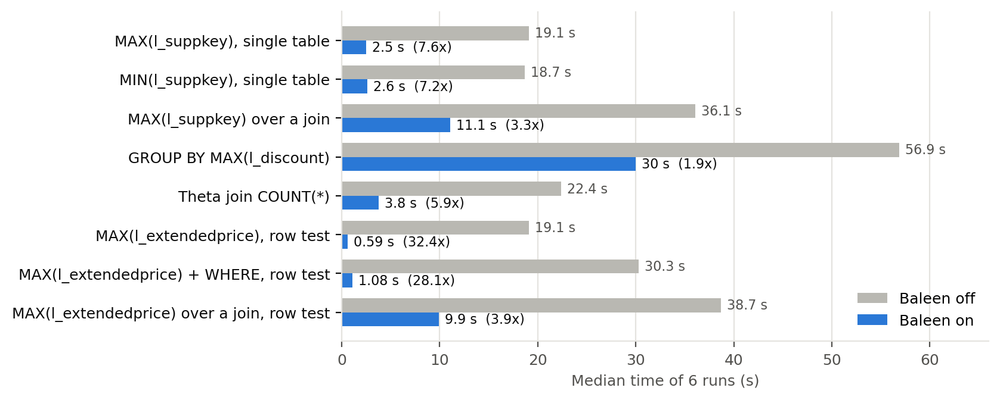
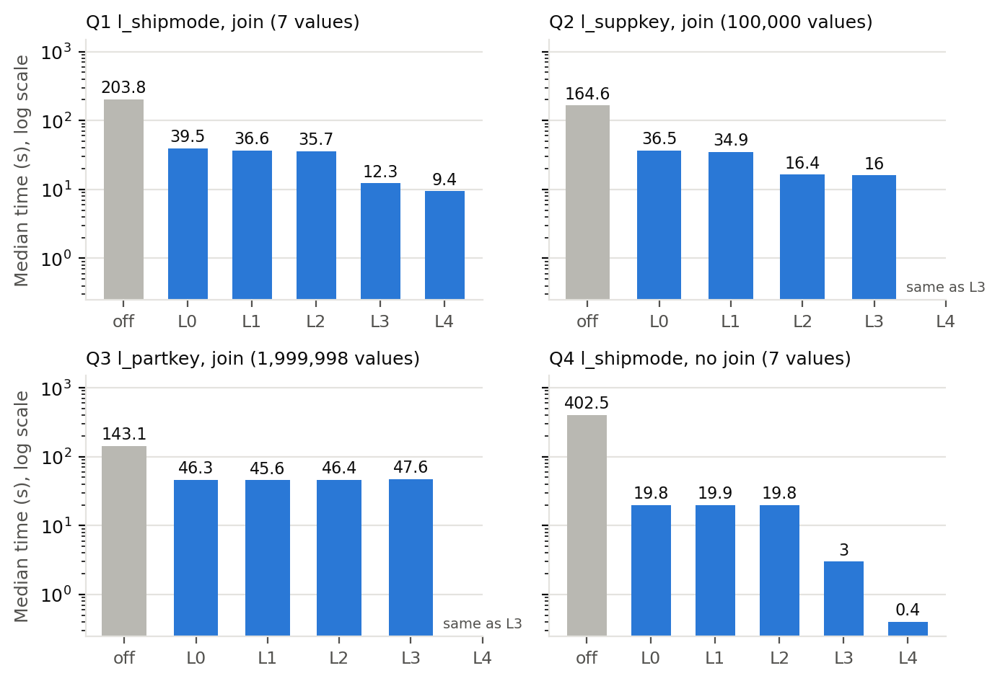
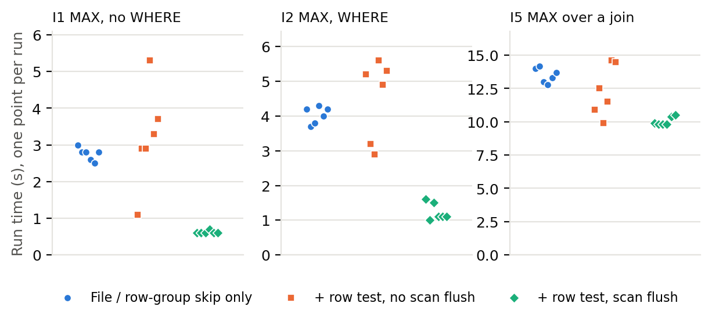

# 1. What this document is

This is a summary of every experiment run so far with the Baleen runtime filters on Apache Iceberg tables. It
is meant as the starting material for an experimentation paper: what was measured, on what, how, the numbers,
and what the numbers do not yet cover. It adds no new measurement.

**Baleen** is a set of filters that a query learns while it runs. Example: while `SELECT MAX(x)` runs, the
best value of `x` found so far is a bound, and any row, Parquet row group or data file that cannot beat the
bound can be dropped or left unread. The filters are built in a fork of Apache AsterixDB. The settings carry
the internal name `plaque` (for example `compiler.plaque.enabled`). **"Baleen off"** always means the same
build with `compiler.plaque.enabled` set to false; it is the baseline in every table.

Every Baleen-on run in this document returned the same result as Baleen off (compared by value for the
aggregates and by md5 of the sorted rows for DISTINCT). The one exception found during the work is listed in
section 9.

# 2. Results at a glance

Best measured configuration per query shape, unordered Iceberg `lineitem` unless stated. Medians of 6 runs.

| Query shape | Baleen off (s) | Baleen on (s) | Speedup | What does the work | Section |
|-----------------------|-------|-------|--------|--------------------------|-----|
| `MAX(l_suppkey)`, single table | 19.1 | 2.5 | 7.76x | File skip, 26 of 30 files | 5.3 |
| `MIN(l_suppkey)`, single table | 18.7 | 2.6 | 7.31x | File skip, 26 of 30 files | 5.3 |
| `MAX(l_suppkey)` over a join | 36.1 | 11.1 | 3.27x | File skip, 26 of 30 files | 5.3 |
| `GROUP BY` with `MAX` | 56.9 | 30.0 | 1.90x | Tuple filter only | 5.3 |
| Theta join, `COUNT(*)` | 22.4 | 3.8 | 5.89x | File skip, 26 of 30 files | 5.3 |
| `MAX(l_extendedprice)` | 19.1 | 0.59 | 32.4x | File skip + row test in scan | 7 |
| `MAX(l_extendedprice)` with `WHERE` | 30.3 | 1.08 | 28.1x | File skip + row test in scan | 7 |
| `MAX(l_extendedprice)` over a join | 38.7 | 9.9 | 3.9x | File skip + row test in scan | 7 |
| `DISTINCT l_shipmode`, join (Q1) | 203.8 | 9.4 | 21.65x | Row-group skip + row drop in reader | 6.5 |
| `DISTINCT l_suppkey`, join (Q2) | 164.6 | 16.0 | 10.31x | File skip, 21 to 26 of 30 files | 6.4 |
| `DISTINCT l_partkey`, join (Q3) | 143.1 | 47.6 | 3.01x | Duplicates dropped before the sort | 6.4 |
| `DISTINCT l_shipmode`, no join (Q4) | 402.5 | 0.4 | 919x | Row-group skip + row drop in reader | 6.5 |
| `DISTINCT l_shipmode` with `WHERE` | 336.2 | 0.69 | 487x | Row-group skip + row drop in reader | 7 |
| `MAX(a - b)` across a join | 57.0 | 45.6 | 1.25x | Tuple filter only (3 runs) | 5.2 |
| `MIN` of a string column with `WHERE` | 32.0 | 30.1 | 1.06x | Nothing applies | 7 |

Notes on this table:

- Q1 and Q4 at 9.4 s and 0.4 s were measured on 2026-11-20 against Baleen-off medians taken on 2026-11-18.
- The 919x is computed from unrounded medians; the rounded values shown give 1006x.
- The last two rows are the cases where Baleen does little on Iceberg today. They are kept here on purpose.

{width=92%}

# 3. Setup

## 3.1 Machine and software

| Item | Value |
|--------------------|------------------------------------------------------------|
| Machine | One server, Intel Xeon E5-4640 v2 at 2.20 GHz, 80 logical CPUs, 125 GB RAM |
| Engine | Apache AsterixDB fork (branch `baleen`), started with `AsterixHyracksIntegrationUtil` |
| Cluster shape | 1 cluster controller and 4 node controllers, **all in one JVM**; 4 scan partitions |
| Memory settings | Join memory 2 GB, sort memory 4 MB, frame 32 KB (recorded 2026-11-16); 64 GB heap and 8 GB buffer cache per node controller (recorded 2026-11-19) |
| Table format | Apache Iceberg 1.12.0, Parquet data files |
| Catalog | Nessie 0.107.5 (RocksDB store), on the same machine |
| Object store | Adobe S3Mock 4.12.4, on the same machine (a local stand-in for S3) |
| Requests | One HTTP request per query to the query service, settings sent as `SET` statements in front of the query |

## 3.2 Data

TPC-H scale factor 10, loaded with a small Java loader that uses Iceberg's own Parquet writer. Column types are
int64, double and string, the same as in the native AsterixDB tables used for comparison.

| Table (`baleen_ice`) | Layout | Rows | Data files | Rows per file | Row groups per file |
|------------------|---------------------|------------|-----|-----------|-----|
| `lineitem` | dbgen order: sorted on `l_orderkey`, unordered on every other column | 59,986,052 | 30 | 2,000,000 | 4 (about 556,000 rows each) |
| `lineitem_by_suppkey` | sorted on `l_suppkey` | 59,986,052 | 30 | 2,000,000 | 4 |
| `orders` | dbgen order | 15,000,000 | | | |

Writer settings: row-group size 16 MB set by the loader; everything else is the Iceberg 1.12.0 default (page
row limit 20,000, page size 1 MB, dictionary size 2 MB). With these settings only `l_shipmode` is
dictionary-encoded among the columns used; `l_suppkey` and `l_partkey` are written plain (section 6.6).

The unit that can be skipped is a file of 2,000,000 rows or a row group of about 556,000 rows. On the native
columnar tables used for comparison it is a page of about 15,000 rows.

## 3.3 Method

- **From 2026-11-16 on:** one discarded warm-up, then 6 measured runs per configuration, Baleen off included,
  configurations taken in turn. The median is reported and every run is kept in a per-run table.
- **2026-11-15 and part of 2026-11-16:** 3 alternating runs per configuration. Marked "3 runs" wherever used.
- **Speedup** is median Baleen off divided by median Baleen on.
- **Counters** come from one log line per scan and per filter operator: files skipped, files read with a
  row-group filter, rows leaving the scan, rows dropped by each filter.
- No file-system cache control between runs beyond the warm-up.

# 4. The mechanisms that were measured

The filter can act at several places. Each later place saves more, because the row is dropped earlier.

| Place | What happens | Applies to |
|-----------------------|-----------------------------------------------|--------------------------|
| Tuple filter above the scan | A row that cannot change the answer is dropped after it was read and decoded | Every filter, no Iceberg-specific code |
| File skip | A data file whose Iceberg min/max bounds cannot beat the bound (MAX/MIN), or whose whole value range is already seen (DISTINCT), is not opened | `long` and `double` columns |
| Row-group skip | The bound, or "value not in the seen list", is added to the Parquet filter; row groups are dropped by footer statistics (MAX/MIN) or by dictionary (DISTINCT) | MAX/MIN: `long`, `double`. DISTINCT: dictionary-encoded columns, list of at most 10,000 values |
| Row drop inside the reader | A row is dropped before it becomes an engine row: by its dictionary entry (DISTINCT) or by comparing its value with the bound (MAX/MIN "row test") | DISTINCT: dictionary-encoded strings. MAX/MIN: numeric columns |

For DISTINCT these places are numbered as **levels**: level 0 is an observer above the join that records
values and drops duplicates before the sort; level 1 adds the tuple filter above the scan; level 2 adds the
file skip; level 3 the row-group skip; level 4 the row drop inside the reader. The set of values seen so far
(the **seen-set**) was built three ways: a hash set (capped at 1,000,000 values), a flat bitmap and a Roaring
bitmap.

Two supporting mechanisms turned out to decide the results:

- **Early send.** Operators hand rows on only when a 32 KB frame is full. When a filter drops almost
  everything, the few rows that would improve the bound wait in a part-filled frame. Early send hands the
  frame on after each input frame (sections 5.3 and 6.3).
- **Scan flush.** The same idea inside the scan itself, once the scan drops rows (section 7).

# 5. MAX / MIN, GROUP BY and theta join

## 5.1 Queries

```sql
-- single-table MAX / MIN
SELECT MAX(l.l_suppkey) AS m FROM lineitem l;
SELECT MIN(l.l_suppkey) AS m FROM lineitem l;
-- MAX over a join
SELECT MAX(l.l_suppkey) AS m FROM lineitem l, orders o
 WHERE l.l_orderkey = o.o_orderkey;
-- GROUP BY MAX
SELECT MAX(l.l_discount) AS m, l.l_shipmode FROM lineitem l
 GROUP BY l.l_shipmode;
-- theta join
SELECT COUNT(*) AS c FROM lineitem l, orders o
 WHERE l.l_suppkey > o.o_custkey AND o.o_orderkey = 3271;
```

All are prefixed with `USE baleen_ice;` and, for Baleen on, ``SET `compiler.plaque.enabled` "true";``.

## 5.2 Tuple filters only, then file and row-group skipping (2026-11-15 and 16, 3 runs)

Tuple filters needed no Iceberg-specific code. File and row-group skipping was written on 2026-11-15.

| Query | Table layout | Off (s) | Tuple filters only (s) | With data skipping (s) | Speedup |
|--------------------------|----------------------|-----|------|------|-------|
| `MAX(l_suppkey)` | sorted on `l_suppkey` | 17.0 | 18.2 | 2.7 | 6.26x |
| `MIN(l_suppkey)` | sorted on `l_suppkey` | 17.5 | not run | 2.4 | 7.18x |
| `MAX(l_orderkey)` | load order | 18.8 | not run | 2.6 | 7.24x |
| Join, `MAX(l_suppkey)` | sorted on `l_suppkey` | 44.9 | not run | 11.0 | 4.09x |
| `MAX(l_suppkey)` | load order | 18.5 | 18.0 | 19.1 | 0.97x |
| Join, `MAX(l_suppkey)` | load order | 35.1 | 33.4 | 33.0 | 1.06x |
| GROUP BY `MAX(l_discount)` | load order | 55.0 | 33.8 | 32.2 | 1.71x |
| `MAX(l_extendedprice - ps_supplycost)` | load order | 57.3 | 45.1 | 45.4 | 1.26x |

Counters: on data ordered on the column, each of the 4 partitions reads one file and skips the rest, 26 of 30
files in total. On unordered `l_suppkey`, 0 files were skipped in this first version.

**Ties dropped (2026-11-16).** The first version kept rows equal to the bound. A row equal to the bound cannot
change a MAX or MIN, so the comparison was made strict. Effect on the unordered table (3 runs):

| Query (unordered `lineitem`) | Off (s) | On (s) | Speedup | With ties kept |
|----------------------------------|------|------|-------|-------|
| `MAX(l_suppkey)` | 20.4 | 2.7 | 7.68x | 1.02x |
| Join, `MAX(l_suppkey)` | 34.7 | 11.2 | 3.10x | 1.02x |
| GROUP BY `MAX(l_discount)` | 62.7 | 36.1 | 1.74x | 1.68x |
| `MAX(l_extendedprice - ps_supplycost)` | 60.4 | 48.5 | 1.25x | 1.25x |

Every file's upper bound for `l_suppkey` is 100000, the global maximum. Once one reader has seen 100000, every
other file ties with the bound and is skipped. This is a property of a column whose extreme value occurs in
every file, not a general gain on unordered data.

**GROUP BY, where the time goes (one profiled run each).** A query that only reads the two columns takes 27.5 s.
Baleen off spends another 27.5 s above the scan, almost all of it sorting 14 to 16 million rows per partition
for a sort-based group-by. With Baleen on the filter passes 5,600,488 of 59,986,052 rows (144,010 after ties
were dropped), the sort falls from about 27 s to about 2.5 s per partition, and the query costs 1.17 times a
bare scan. No file or row-group statistic can help this query (`l_discount` has 11 values in every file).

**Queries with a `WHERE` (single runs, 2026-11-16).** `MAX(l_suppkey) ... WHERE l_quantity < 3` on the sorted
table: 33.9 s off, 3.9 s on. `MIN(l_suppkey) ... WHERE l_shipmode = 'AIR'`: 35.0 s off, 3.9 s on.
`MAX(l_orderkey) ... WHERE l_quantity < 3.0` on `lineitem`: 28.6 s off, 4.3 s on. 26 of 30 files skipped in each.

## 5.3 Iceberg against native columnar, unordered data (2026-11-19, 6 runs)

| Filter type | Iceberg off to on (s) | Iceberg speedup | Native off to on (s) | Native speedup | Iceberg files skipped (of 30) |
|----------------|----------------|--------|----------------|--------|------------------|
| MAX, single table | 19.1 to 2.5 | 7.76x | 23.8 to 2.1 | 11.60x | 26 in 6 of 6 runs |
| MIN, single table | 18.7 to 2.6 | 7.31x | 24.1 to 4.6 | 5.27x | 26 in 6 of 6 runs |
| MAX with join | 36.1 to 11.1 | 3.27x | 34.3 to 7.9 | 4.36x | 26 in 6 of 6 runs |
| GROUP BY MAX | 56.9 to 30.0 | 1.90x | 53.2 to 34.7 | 1.54x | 0, tuple filter only |
| Theta join | 22.4 to 3.8 | 5.89x | 25.7 to 0.9 | 28.90x | 26 in 6 of 6 runs |

All runs behind the Iceberg column (seconds):

| Query | Off, runs 1 to 6 | On, runs 1 to 6 |
|------------------|-------------------------------|-------------------------------|
| MAX | 20.3 19.5 19.1 19.1 18.0 19.1 | 2.2 2.8 2.5 2.4 2.9 2.5 |
| MIN | 19.5 18.6 19.4 18.8 17.7 18.0 | 2.8 2.4 3.0 2.5 2.6 2.4 |
| MAX with join | 35.1 34.1 34.8 37.8 37.1 40.1 | 11.2 11.2 10.7 10.9 10.5 11.7 |
| GROUP BY MAX | 57.1 56.4 57.3 57.1 56.1 56.7 | 29.9 29.7 29.6 30.8 30.1 30.7 |
| Theta join | 21.3 22.4 22.7 21.0 22.4 22.8 | 3.8 4.1 3.4 3.6 4.0 3.8 |

The native MAX, join and GROUP BY numbers were measured before the early-send fix described next and were not
rerun; the native MIN is also from before the fix.

**Finding: the bound stalled just short of the maximum.** The first matrix of that day looked like this:

| Query | On, runs 1 to 6 (s) | Speedup | Files skipped, runs 1 to 6 |
|---------------|----------------------------|-------|----------------------|
| MAX | 2.3 16.0 2.6 2.5 2.7 4.8 | 6.88x | 26 2 26 26 26 22 |
| MIN | 16.5 17.0 15.9 16.4 15.8 9.1 | 1.10x | 2 1 2 2 2 14 |
| MAX with join | 29.2 34.2 30.9 11.3 33.4 33.1 | 1.09x | 2 0 2 26 0 1 |

A log line per file open showed the bound fixed at 99985 (MAX) and 10 (MIN) from the second file to the last.
Every file's bound is 100000 (or 1), so nothing can be skipped until the bound reaches exactly that value. The
tuple filter passed its output on only when a frame was full; near the maximum the few rows that still pass
never fill a frame, so the aggregate never saw them. After making the filter (and the joins between filter and
aggregate) send after every input frame: 26 of 30 files skipped in 18 of 18 runs, and MIN went from 1.10x to
7.31x. The 3.10x for the join in section 5.2 was a median of 3 runs in which 2 happened to skip.

**Sorted tables (6 runs, before the fix).** Iceberg sorted on `l_suppkey`: MAX 17.7 to 2.4 s (7.52x), MIN 18.1
to 2.4 s (7.53x), MAX with join 46.1 to 11.2 s (4.12x), GROUP BY 56.1 to 28.3 s (1.98x). After the fix MAX was
7.33x and MIN 7.10x. So on this data the unordered and sorted Iceberg tables give the same speedup for
`l_suppkey`.

# 6. DISTINCT

## 6.1 Queries

```sql
-- Q1: 7 values, string
SELECT DISTINCT l.l_shipmode FROM lineitem l, orders o
 WHERE l.l_orderkey = o.o_orderkey AND o.o_orderstatus = 'F';
-- Q2: 100,000 values, BIGINT
SELECT DISTINCT l.l_suppkey FROM lineitem l, orders o
 WHERE l.l_orderkey = o.o_orderkey AND o.o_orderstatus = 'F';
-- Q3: 1,999,998 values, BIGINT
SELECT DISTINCT l.l_partkey FROM lineitem l, orders o
 WHERE l.l_orderkey = o.o_orderkey AND o.o_orderstatus = 'F';
-- Q4: no join
SELECT DISTINCT l.l_shipmode FROM lineitem l;
```

Settings in front of a Baleen-on run:

```sql
USE baleen_ice;
SET `compiler.plaque.enabled` "true";
SET `compiler.plaque.distinct.set` "<hash|flat|roaring>";
SET `compiler.plaque.distinct.level` "<0|1|2|3|4>";
```

`lineitem` is the probe side of the join; 29,058,120 rows leave the join. Scope of all DISTINCT work: one
DISTINCT expression, with the column on the probe side.

## 6.2 Every seen-set at every level (2026-11-17, 312 runs)

Before any early-send change, with one seen-set shared by the 4 partitions. Median of 6 runs, seconds, speedup
over Baleen off in brackets.

| Query | Off | Set | Level 0 | Level 1 | Level 2 | Level 3 |
|------|------|--------|-------------|-------------|-------------|--------------|
| Q1 | 212.7 | hash | 38.2 (5.57x) | 35.1 (6.05x) | 36.2 (5.87x) | 12.4 (17.10x) |
| | | flat | 37.2 (5.71x) | 36.3 (5.86x) | 35.4 (6.00x) | 12.6 (16.89x) |
| | | roaring | 36.6 (5.81x) | 36.6 (5.80x) | 33.9 (6.28x) | 12.7 (16.73x) |
| Q2 | 158.2 | hash | 35.6 (4.44x) | 41.9 (3.78x) | 42.2 (3.75x) | 42.6 (3.71x) |
| | | flat | 35.6 (4.44x) | 34.7 (4.56x) | 21.2 (7.47x) | 25.1 (6.30x) |
| | | roaring | 36.4 (4.35x) | 34.1 (4.64x) | 20.4 (7.75x) | 27.2 (5.81x) |
| Q3 | 123.2 | hash | 93.2 (1.32x) | 103.3 (1.19x) | 100.2 (1.23x) | 101.1 (1.22x) |
| | | flat | 45.1 (2.73x) | 42.2 (2.92x) | 41.1 (2.99x) | 42.2 (2.92x) |
| | | roaring | 43.0 (2.86x) | 41.4 (2.97x) | 41.5 (2.97x) | 41.8 (2.94x) |
| Q4 | 401.4 | hash | 19.0 (21.15x) | 19.5 (20.62x) | 19.0 (21.16x) | 2.9 (140.65x) |
| | | flat | 18.9 (21.25x) | 19.0 (21.14x) | 18.9 (21.27x) | 2.8 (142.68x) |
| | | roaring | 21.3 (18.86x) | 21.0 (19.13x) | 21.2 (18.95x) | 3.1 (129.80x) |

What the table shows:

- **The observer alone (level 0) gives most of the gain.** A profiled run shows why: with Baleen off the sort
  receives 29,058,120 rows on Q1 and 59,986,052 on Q4; with the observer it receives 28 (7 values from each of
  4 partitions). On the slowest partition the sort took 137.8 s of Q1's 206 s and 294.8 s of Q4's 418 s.
- **The tuple filter (level 1) adds a few percent at most.** It drops over 99% of scan rows on Q1 and Q2, but
  those rows were already read and decoded.
- **The next large step comes only from not reading data:** level 3 on Q1 and Q4 (26 of 30 files opened with
  the row-group filter return nothing; rows leaving the scan fall from 59,986,052 to 8,000,000), level 2 on Q2.
- **Q2 file skipping was unstable:** between 0 and 24 of 30 files skipped across runs of one configuration,
  times from 15.7 s to 35.3 s. This is the subject of section 6.3.
- **Hash is the wrong seen-set for many values.** On Q3 it stops recording at its 1,000,000 cap and about 14.8
  million rows pass. It never skips a file (its file test passes only for a single-value file). On Q2 its
  membership test costs as much as the join probe it saves (profiled: 51.3 s against 51.6 s, summed over
  partitions), and the cost moves into the scan's thread, so level 1 is slower than level 0.
- **Q3 can never skip a file:** the file bounds span 1 to 2,000,000 and two values in that range never occur.

{width=88%}

## 6.3 Early send: making the file skip stable (2026-11-17, 162 + 342 runs)

Between the filter above the scan and the observer above the join, a row passes
`scan, tuple filter, exchange, hash join probe, project, observer`, and each operator hands on a frame only
when it is full. A file is skipped only when every value in its range is in the seen-set. Late in the query
the filter drops over 99% of rows, the rows carrying the last unseen values sit in part-filled frames, and the
next file is read because one value is missing. The better the filter works, the slower the last values travel.

Three places can send early: `f` the tuple filter after each input frame, `j` the hash join after each probe
frame, `o` the observer passing an early send upward. Ablation at level 2, 6 runs per cell, Baleen-off medians
Q1 212.8 s, Q2 160.9 s, Q3 143.0 s.

Median time (s):

| Setting | Q1 hash | Q1 flat | Q1 roaring | Q2 hash | Q2 flat | Q2 roaring | Q3 hash | Q3 flat | Q3 roaring |
|-----|------|------|------|------|------|------|-------|------|------|
| none | 36.3 | 35.6 | 35.7 | 43.2 | 29.2 | 20.1 | 104.2 | 41.3 | 42.8 |
| `f` | 35.8 | 36.5 | 36.1 | 42.3 | 29.7 | 16.5 | 121.9 | 43.5 | 45.3 |
| `j` | 35.2 | 35.4 | 34.6 | 41.7 | 17.1 | 15.5 | 104.9 | 41.6 | 43.3 |
| `fj` | 35.8 | 36.0 | 34.7 | 40.5 | 12.6 | 12.2 | 120.2 | 43.1 | 45.1 |
| `jo` | 35.7 | 34.9 | 34.9 | 42.0 | 26.1 | 22.6 | 101.4 | 43.8 | 43.4 |
| `fjo` | 34.6 | 35.1 | 35.8 | 42.2 | 12.6 | 12.8 | 116.4 | 46.9 | 48.1 |

Q2, files skipped of 30 in each of the 6 runs (Q1 and Q3 skip no file at any setting):

| Setting | Hash | Flat | Roaring |
|------|-------------|---------------------|---------------------|
| none | 0 0 0 0 0 0 | 18 4 6 0 0 14 | 22 2 14 19 16 18 |
| `f` | 0 0 0 0 0 0 | 0 6 14 0 2 10 | 22 22 22 26 0 0 |
| `j` | 0 0 0 0 0 0 | 3 18 22 22 17 22 | 10 23 23 26 26 25 |
| `fj` | 0 0 0 0 0 0 | 26 26 26 26 26 26 | 26 26 26 26 26 26 |
| `jo` | 0 0 0 0 0 0 | 22 22 1 14 1 1 | 26 1 2 22 2 22 |
| `fjo` | 0 0 0 0 0 0 | 26 26 26 26 26 26 | 26 26 26 26 26 26 |

{width=80%}

- **Q2 needs both `f` and `j`.** With `fj`, Q2 runs in 12.2 s (Roaring) and 12.6 s (flat) against 160.9 s:
  13.2x and 12.8x, and the same in every run.
- **Early sending has a cost where nothing can be skipped.** Q3, `fj` against none: +1.8 s flat, +2.3 s
  Roaring, +16.0 s hash. With `f` the filter sends 28,563 to 54,985 frames where it sends 3,902 to 28,123
  without.
- **`o` adds nothing** and is slower on Q3. A bug of exactly this kind was found on the way: the observer
  forwarded every early send to the exchange above it, which made Q3 6 s slower until the observer stopped
  doing so.
- **Default chosen: `fj`**, by a rule fixed before the ablation (among settings that skip 26 of 30 in all runs
  for flat and Roaring, the lowest Q3 time).

## 6.4 One seen-set per node, values exchanged by message (2026-11-18, 168 runs)

Until here the 4 node controllers shared one seen-set because they run in one JVM. From 2026-11-18 each node
has its own and learns the others' values through the cluster controller every 5,000 rows. Median of 6 runs,
seconds, speedup in brackets; flush `fj`.

| Query | Off | hash L2 | hash L3 | flat L2 | flat L3 | roaring L2 | roaring L3 |
|-----|------|------------|------------|------------|------------|------------|------------|
| Q1 | 203.8 | 36.2 (5.63x) | 12.8 (15.97x) | 35.5 (5.74x) | 12.7 (16.07x) | 35.7 (5.72x) | 12.3 (16.56x) |
| Q2 | 164.6 | 44.3 (3.72x) | 44.2 (3.73x) | 16.0 (10.27x) | 16.3 (10.09x) | 16.4 (10.03x) | 16.0 (10.31x) |
| Q3 | 143.1 | 126.2 (1.13x) | 124.8 (1.15x) | 44.4 (3.22x) | 44.1 (3.24x) | 46.4 (3.09x) | 47.6 (3.01x) |
| Q4 | 402.5 | 19.6 (20.56x) | 2.9 (137.28x) | 18.9 (21.26x) | 3.0 (135.92x) | 19.8 (20.28x) | 3.0 (134.04x) |

Q2 now skips 21 to 26 of 30 files per run (flat and Roaring) instead of 26 in every run, and takes 16.0 to
16.4 s instead of 12.2 to 12.8 s: the skip now waits for values from the other nodes. Messages per run, summed
over the 4 observers: Q2 30 to 31 sent and about 300,000 values merged; Q3 411 to 412 sent and about 6,000,000
values merged; Q4 4 sent, 21 values merged.

Levels 0 and 1 on the same build (2026-11-19, 3 runs per cell) agree with section 6.2 within 4.5 s in 23 of 24
cells; the exception is Q3 hash level 1 (126.7 s against 103.3 s), which matches the 126.2 s above.

## 6.5 Level 4: rows dropped inside the Parquet reader (2026-11-20, 72 runs)

Level 3 skips a row group only if every dictionary entry is already seen; otherwise every row is decoded, made
into an engine row and then dropped. Level 4 drops such a row by its dictionary entry inside the reader. Median
of 6 runs, seconds; Baleen off was not rerun, speedups use the medians of 2026-11-18 (Q1 203.8 s, Q4 402.5 s).

| Query | hash L3 | hash L4 | flat L3 | flat L4 | roaring L3 | roaring L4 |
|------|------|------|------|------|------|------|
| Q1 | 12.9 | 9.7 | 12.7 | 9.6 | 13.1 | 9.4 |
| Q4 | 2.8 | 0.4 | 2.7 | 0.4 | 2.9 | 0.4 |
| Q1 speedup | 15.85x | 21.06x | 16.08x | 21.19x | 15.61x | 21.65x |
| Q4 speedup | 143.78x | 922.26x | 146.90x | 902.65x | 137.63x | 919.42x |

Rows (Roaring, median run): at level 3 8,000,000 rows leave the scan on both queries (the first file of each of
the 4 partitions, opened while the seen-set was empty). At level 4, 4,114 leave the scan on Q1 and 12,347 on Q4.

How Q4 went from 402.5 s to 0.4 s:

| Q4 | Rows leaving the scan | Time (s) | Over Baleen off |
|-----------------------------------------|------------|-------|------|
| Baleen off | 59,986,052 | 402.5 | 1x |
| Level 2: observer, tuple filter, file skip | 59,986,052 | 19.8 | 20x |
| Level 3: + row groups skipped by dictionary | 8,000,000 | 2.9 | 138x |
| Level 4: + rows dropped inside the reader | 12,347 | 0.4 | 919x |

Level 4 acts on dictionary-encoded string columns only. Q2 and Q3 (BIGINT, not dictionary-encoded) were checked
with two single runs each and behave as at level 3 (Q2 16.0 and 19.2 s; Q3 44.7 and 47.8 s).

## 6.6 Why the high-cardinality columns have no dictionary (2026-11-17)

Level 3 and level 4 depend on a Parquet dictionary. A test with the loader's writer on 2,000,000 random longs:

| Value range | Writer settings | Dictionary page |
|--------------|------------------------------------------------------|-----|
| 1 to 100,000 | loader's settings (page row limit 20,000) | no |
| 1 to 100,000 | page row limit 1,000,000 | yes |
| 1 to 2,000,000 | page row limit 10,000,000, page size 32 MB, dictionary size 32 MB, row group 128 MB | yes |

With 20,000 rows drawn from 100,000 values almost every value in the first page is new, the dictionary saves
nothing on that page and the column is written plain. Any Iceberg table written with default settings will
behave this way for such a column. This was confirmed again on 2026-11-22: `DISTINCT l_partkey` at level 4
dropped 0 rows in the reader in every run (section 7.3).

## 6.7 DISTINCT: Iceberg and native side by side

Roaring, level 4, medians of 6 runs; different days and, for Iceberg Q2 and Q3, level 3.

| Query | Native off (s) | Native on (s) | Native speedup | Iceberg off (s) | Iceberg on (s) | Iceberg speedup |
|-----|-------|------|--------|-------|----------------|---------|
| Q1 | 155.0 | 14.5 | 10.72x | 203.8 | 9.4 | 21.65x |
| Q2 | 125.0 | 9.5 | 13.17x | 164.6 | 16.0 (level 3) | 10.31x |
| Q3 | 108.1 | 21.7 | 4.98x | 143.1 | 47.6 (level 3) | 3.01x |
| Q4 | 295.5 | 8.9 | 33.38x | 402.5 | 0.4 | 919.42x |

Native drops rows inside the scan for BIGINT as well, which is why it is ahead on Q2 and Q3. Iceberg is ahead
on the dictionary-encoded column, where whole row groups are never decoded.

# 7. Row test inside the scan for MAX / MIN, and the scan flush (2026-11-22)

The row test compares each value with the bound inside the reader, before an engine row is built. It was built
together with one shared row filter that combines the query's own `WHERE` with the Baleen check, so DISTINCT
with a `WHERE` on the same table also gets its row drop.

## 7.1 Queries and configurations

```sql
-- I1
SELECT MAX(l.l_extendedprice) AS m FROM baleen_ice.lineitem l;
-- I2
SELECT MAX(l.l_extendedprice) AS m FROM baleen_ice.lineitem l
 WHERE l.l_shipmode = "AIR";
-- I3
SELECT MIN(l.l_shipdate) AS m FROM baleen_ice.lineitem l
 WHERE l.l_quantity > 10;
-- I4 (table sorted on the column)
SELECT MAX(l.l_suppkey) AS m FROM baleen_ice.lineitem_by_suppkey l;
-- I5
SELECT MAX(l.l_extendedprice) AS m
  FROM baleen_ice.lineitem l, baleen_ice.orders o
 WHERE l.l_orderkey = o.o_orderkey AND o.o_orderstatus = "F";
-- I6
SELECT DISTINCT l.l_shipmode FROM baleen_ice.lineitem l
 WHERE l.l_quantity > 10;
```

| Configuration | Settings sent |
|--------------------------------|--------------------------------------------------------|
| Baleen off | `compiler.plaque.enabled "false"` |
| Skip only (row test off) | `enabled "true"; rowfilter "false"; distinct.level "3"` |
| Row test, no scan flush | `enabled "true"; rowfilter "true"; distinct.level "4"; scanflush "false"` |
| Row test, scan flush | `enabled "true"; rowfilter "true"; distinct.level "4"; scanflush "true"` |

The same run also covered six native queries (N1 to N6); they are in the dated note and not repeated here.

## 7.2 Results

Median [min to max] of 6 runs, seconds. The first three configurations were run in the morning (228 runs
including native), the last in the afternoon (84 runs including native).

| Query | Baleen off | Skip only | Row test, no scan flush | Row test, scan flush |
|------|------------------|------------------|------------------|------------------|
| I1 | 19.14 [18.61-19.70] | 2.77 [2.55-3.05] | 3.08 [1.10-5.27] | 0.59 [0.58-0.70] |
| I2 | 30.30 [29.01-32.05] | 4.12 [3.69-4.35] | 5.05 [2.94-5.64] | 1.08 [1.01-1.55] |
| I3 | 32.03 [31.31-32.48] | 31.43 [30.73-33.58] | 31.37 [30.67-31.95] | 30.08 [29.46-31.95] |
| I4 | 17.60 [17.07-18.29] | 2.56 [2.29-2.68] | 2.81 [2.59-2.90] | 2.94 [2.61-3.29] |
| I5 | 38.75 [37.07-39.96] | 13.53 [12.77-14.22] | 12.01 [9.89-14.60] | 9.90 [9.78-10.52] |
| I6 | 336.24 [328.73-360.60] | 4.75 [4.29-5.32] | 0.70 [0.61-0.73] | 0.69 [0.63-0.74] |

Speedup of the last column:

| Query | Over Baleen off | Over skip only |
|------|--------|--------|
| I1 | 32.4x | 4.7x |
| I2 | 28.1x | 3.8x |
| I3 | 1.06x | 1.04x |
| I4 | 6.0x | 0.87x |
| I5 | 3.9x | 1.37x |
| I6 | 487x | 6.9x |

Files skipped of 30, per run:

| Query | Skip only | Row test, no scan flush | Row test, scan flush |
|------|---------------|----------------------|------------------|
| I1 | 26 every run | 22, 2, 3, 2, 2, 1 | 26 every run |
| I2 | 26 every run | 0, 13, 14, 4, 0, 2 | 24 to 25 |
| I5 | 24 every run | 12, 2, 15, 10, 1, 3 | 22 to 24 |

{width=95%}

**Finding: the row test starved its own bound.** Without the scan flush, switching the row test on made I1 and
I2 slower than file skipping alone (2.77 to 3.08 s, 4.12 to 5.05 s) and erratic, and file skipping collapsed
from 26 files to as few as 1. Cause: the scan sends a frame only when it is full. With the row test on, only
rows that beat the bound enter the frame, about 10,000 in a whole run, so a partition's second frame is
typically sent only when its scan ends. The rows that would raise the bound wait inside the scan, and file
skip, row-group skip and the row test itself keep using the value from the first frame. The scan flush sends
the kept rows before the scan decides on the next file. It restores 26 of 30 files skipped, removes the spread
(I1 [1.10-5.27] to [0.58-0.70]) and puts the row test 3.8x to 4.7x ahead of file skipping alone on I1 and I2.

Other observations:

- **I6:** DISTINCT with a `WHERE` on the same table now gets the row drop: 4.75 s (level 3) to 0.69 s (level 4).
  Before this work that query shape did not compile at level 4.
- **I3:** nothing is dropped. On Iceberg the MAX/MIN row test is not applied to string columns, by design, and
  the data is unordered on `l_shipdate`. The log says so.
- **I4** (sorted on the column) is slightly slower with the row test than without (2.94 against 2.56 s): new
  maxima keep arriving in sorted order, so 1.87 million of 7.99 million rows pass the row test anyway.

## 7.3 Queries chosen to show harm from the scan flush

```sql
-- H4
SELECT DISTINCT l.l_partkey FROM baleen_ice.lineitem l
 WHERE l.l_quantity > 10;
-- H5
SELECT DISTINCT l.l_partkey
  FROM baleen_ice.lineitem l, baleen_ice.orders o
 WHERE l.l_orderkey = o.o_orderkey AND o.o_orderstatus = "F";
```

Median [min to max] of 6 runs, seconds:

| Query | Baleen off | Skip only | Row test, no scan flush | Row test, scan flush |
|-----|------------------|----------------|----------------|----------------|
| H4 | 225.9 [218.7-240.8] | 37.2 [34.7-39.6] | 36.1 [34.5-38.6] | 37.6 [36.0-40.5] |
| H5 | 153.6 [152.6-164.3] | 46.5 [45.1-49.0] | 45.7 [44.7-48.2] | 46.3 [45.1-48.8] |

No measurable cost on Iceberg: 26 early sends per run. Level 4 dropped 0 rows in the reader in every run,
because `l_partkey` is not dictionary-encoded (section 6.6). On the native table the same join query (H2) was
9% slower with the flush (24.1 to 26.2 s, ranges do not overlap), the only measured harm.

# 8. What the experiments say, across sections

**Measured.**

1. A filter learned at run time can skip Iceberg data files and Parquet row groups, and this is where the
   large gains come from: 6x to 8x on single-table MAX/MIN, 3x to 4x over a join, 6x on a theta join.
2. Tuple filters alone give nothing on a scan-bound query (0.97x to 1.05x on single-table MAX) and up to 1.9x
   where they remove work above the scan (the sort of a GROUP BY).
3. For DISTINCT, dropping duplicates before the sort gives 4x to 21x by itself; not reading data gives the
   rest, up to 919x on a 7-value column.
4. The finer the place where a row is dropped, the larger the gain, as long as the format lets the reader act
   there. On Iceberg that depends on the Parquet encoding: a dictionary-encoded column gets row-group skip and
   row drop; a plain-encoded column gets neither.
5. On unordered data file skipping still works when the extreme value occurs in many files, or when every value
   in a file's range has been seen. It does not work when a file's range contains a value that never occurs (Q3).

**A pattern that appeared three times.** A runtime filter both uses the bound and, through the rows it lets
pass, produces it. Each time the filter became more selective, the rows that would improve the bound travelled
more slowly, because operators hand on only full frames:

| Where | Symptom | Fix | Section |
|-----------------------|------------------------------------|----------------------|-----|
| DISTINCT, filter to observer across a join | Files skipped per run between 0 and 24 | Early send at filter and join (`fj`) | 6.3 |
| MAX/MIN tuple filter to aggregate | Bound fixed at 99985, MIN at 1.10x | Early send at filter and joins | 5.3 |
| MAX/MIN row test inside the scan | Files skipped fell from 26 to as few as 1 | Scan flush | 7.2 |

Whether this is new was not searched in the literature.

# 9. Limits of the evidence

| Limit | What it affects |
|--------------------------------|------------------------------------------------------------|
| All 4 node controllers in one JVM on one machine | No network between nodes. Bounds and seen-set values reach other nodes with no real delay. Section 6.4 shows the skip already weakens (26 to 21-26 files) when values travel by message inside one process. |
| S3Mock on the same machine | A skipped file saves a local read. On a real object store it would also save network requests; not measured. |
| One data size (SF10), one file size, one row-group size | No scaling curve. No experiment varies file size, row-group size or page settings, although section 6.6 shows the writer settings decide whether levels 3 and 4 can act. |
| One sort order besides load order | Only `lineitem_by_suppkey`. No partially ordered or partitioned table. |
| Synthetic TPC-H columns | `l_suppkey` has its maximum in every file, which is what makes file skipping work on the unordered table. |
| Run counts | Section 5.2 uses 3 runs; several checks are single runs (marked). Level 0 and 1 on the current build have 3 runs. |
| Baselines from another day | Level 4 speedups (section 6.5) use Baleen-off medians of 2026-11-18. |
| Mixed before/after numbers | Native MAX, MIN, join and GROUP BY in section 5.3 predate the early-send fix. |
| Tables without deletes or updates | Paths with Iceberg delete files and the variant-pruned read were not exercised. |
| No cache control | Only the discarded warm-up. One Baleen-off re-check on 2026-11-22 came out 5% above the morning's slowest run, not explained. |

Not built or not measured on Iceberg: file skipping for the cross-table expression `MAX(a - b)` (1.25x today,
6.7x to 7.4x on native where pages are skipped); any data skipping for GROUP BY; Top-K; MAX/MIN row test on
string columns; DISTINCT row drop on plain-encoded columns; DISTINCT with more than one expression or with the
column on the build side of the join; `int` columns for MAX/MIN skipping.

**Wrong results found during the work.** None on Iceberg. One on the native columnar table (2026-11-20): Q2 at
level 2 returned 100,004 rows instead of 100,000, because a skipped leaf on a scan without a row filter came
out as empty records. Fixed the same day; a row filter is now always attached with the leaf skip.

# 10. Index of experiments and sources

Notes are in the project's `plaque/` folder; raw files are in `build_logs/`.

| Date | Experiment | Runs | Note | Raw files |
|------|--------------------------|------------|------------------------------|--------------------------------|
| 11-15 | Tuple filters only; file and row-group skipping | 3 per cell | `ICEBERG_DATA_SKIPPING` | `iceberg_step3`, `iceberg_dataskip` |
| 11-16 | Review fixes, ties dropped, WHERE and theta checks | 3 per cell; single runs | `ICEBERG_REVIEW_TODO` | `iceberg_reviewfix`, `iceberg_strict` |
| 11-16 | DISTINCT first results (replaced by the next row) | 1 off, 3 per variant | `DISTINCT_FILTER_RESULTS` | `distinct` |
| 11-17 | DISTINCT, every set at every level | 312 | `DISTINCT_UNIFORM_BENCHMARK` | `distinct_full` |
| 11-17 | Early send, before and after | 162 | `DISTINCT_FLUSH_RESULTS` | `distinct_flush` |
| 11-17 | Early-send ablation | 342 | `DISTINCT_FLUSH_ABLATION` | `distinct_ablation` |
| 11-17 | Seen-set propagation check; dictionary test | single runs | `DISTINCT_PROPAGATION` | `distinct_prop` |
| 11-18 | Per-node seen-sets | 168 | `DISTINCT_PERNODE_VERIFICATION` | `distinct_pernode` |
| 11-19 | Levels 0 and 1; profiled runs | 3 per cell | `DISTINCT_LEVELS_0_1_RESULTS` | `distinct_levels01`; folder `profile_distinct_1119/` |
| 11-19 | Iceberg against native; bound stall | 6 per cell | `ICEBERG_VS_NATIVE_RESULTS` | files `bench_matrix_1119*.md` |
| 11-20 | DISTINCT level 4 | 72 | `DISTINCT_LEVEL4` | `distinct_level4` |
| 11-22 | Row test for MAX/MIN, DISTINCT with WHERE | 228 (half Iceberg) | `R1A_RESULTS` | folder `bench_r1a_2026_11_22/` (`runs.csv`) |
| 11-22 | Scan flush; harm queries | 84 + 125 (part Iceberg) | `SCAN_FLUSH_RESULTS` | folder `bench_scanflush_2026_11_22/` |

A note named `X` dated 11-dd is the file `2026_11_dd_PLAQUE_X.md`. A raw file named `y` is
`bench_result_y.md`, with every run in `bench_result_y_per_run.md` where that file exists.

The early-send story is told in one place in the note `DISTINCT_EARLY_FLUSH` (11-19). The native DISTINCT
benchmark used in section 6.7 is the note `DISTINCT_NATIVE_BENCHMARK` (11-20).

# 11. Decisions made without asking

- Organised by filter type and not by date; the index in section 10 gives the dates.
- Native columnar numbers are included only where they were measured next to an Iceberg number.
- Per-run tables are given for the Iceberg-against-native matrix and as ranges for the row test; for the
  DISTINCT benchmarks only medians are repeated and the per-run tables stay in the dated notes.
- Four figures were added, drawn from the tables in this document.
- The first DISTINCT results of 2026-11-16 (1 Baleen-off run, 3 runs per variant) are listed in the index but
  their numbers are not repeated, because the 312-run benchmark replaced them.
- Section 8 names the recurring delayed-bound pattern as a candidate point for the paper.
- No author name is on the document.

# 12. Stated but not verified

- Every number was copied from the dated notes. Against the raw result files I re-checked only: the Iceberg
  rows of the 2026-11-19 after-fix matrix, the level 4 summary, and the I1 to I6 rows of both 2026-11-22
  summaries. The other tables were not re-checked against raw files today.
- CPU model, CPU count and RAM were read from the machine today. Heap, buffer cache, join memory, sort memory
  and frame size are as recorded in the notes on the dates given; that they were the same on every other day
  was not checked.
- Explanations marked in the notes as unverified remain so, in particular: that the cost of early send on Q3
  is the extra frames; that the 21 to 26 file skip with per-node seen-sets is caused by message delay; why hash
  is slower at level 1 on Q2 beyond the one profiled run; the exact rule by which the Parquet writer abandons a
  dictionary.
- That the gains would be larger on a real object store, and how the filters behave with node controllers in
  separate processes, are expectations with no measurement behind them.
